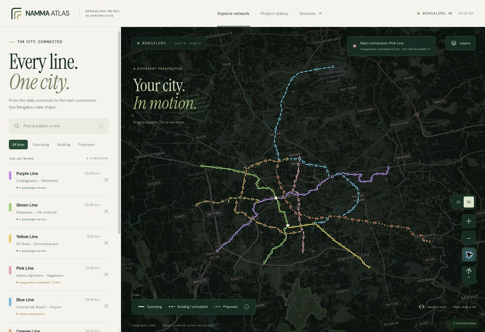
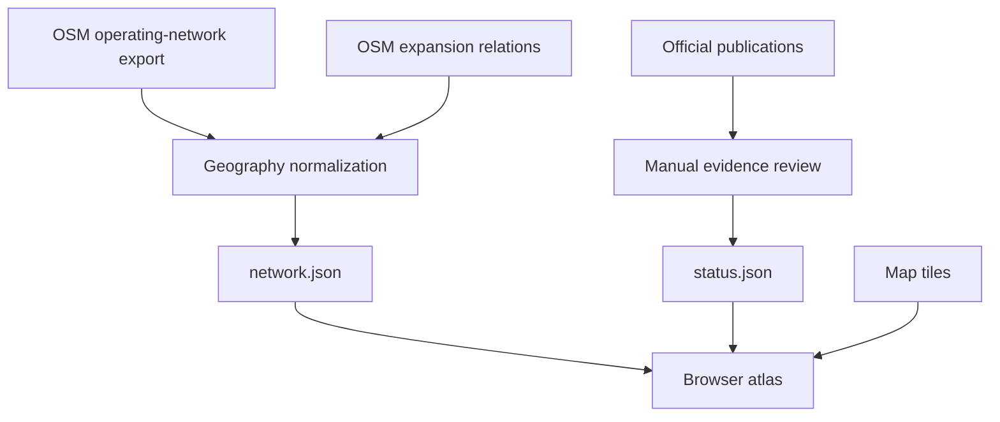

# Namma Atlas

An interactive geographic atlas of Bengaluru's Namma Metro, showing operating lines, construction corridors and proposed connections on a real street map.

[Open the hosted atlas](https://namma-atlas-bengaluru.inzi00.chatgpt.site) · [Status and evidence register](dist/data/status.json) · [Attributed geography](dist/data/network.json)

The hosted preview currently requires the owner's ChatGPT account. Repository visibility and website access are separate settings.



## Features

- Eight corridors: Purple, Green, Yellow, Pink, Blue, Orange, Magadi Road and Red.
- Station search and aliases, clickable stations, corridor selection, operating/construction/proposed filters.
- Interactive 2D/3D views, neighbourhood exploration, rotation and phone controls.
- Official-source links with publication dates, measurement dates and evidence scope.
- A Canvas compatibility renderer when WebGL is unavailable.

**This is an independent atlas, not an official BMRCL application or a live service feed.** The checked-in status snapshot was researched on **13 November 2026 IST, before the scheduled Pink Line inauguration**. Opening the website does not refresh that research.

## How data is fetched

Geography, official status and the surrounding street map are collected independently.

| Information | Source | Fetch timing | Storage |
| --- | --- | --- | --- |
| Operating alignments and station positions | OSM-derived GeoJSON from [Vonter/bmrcl-gtfs](https://github.com/Vonter/bmrcl-gtfs) | During dataset preparation | `dist/data/network.json` |
| Expansion alignments and station positions | OpenStreetMap full-relation API | During dataset preparation | `dist/data/network.json` |
| Operating/project status, lengths and historical progress | BMRCL, PIB/PMO and MoHUA parliamentary publications | Manually researched and checked against originals | `dist/data/status.json` |
| Vector street map, building footprints, glyphs and sprites | [OpenFreeMap](https://openfreemap.org/) | In the browser during interactive viewing | Browser HTTP cache |
| Compatibility street map | [OpenStreetMap standard raster tiles](https://operations.osmfoundation.org/policies/tiles/) | In the browser for the current viewport | Browser HTTP cache |

On startup, the browser fetches `network.json` and `status.json` from this site in parallel. It does **not** scrape BMRCL, call an official status API or infer service status from OSM tags. There is no backend or scheduled updater.



### Geography collection

The initial operating-network input was downloaded from:

```text
https://raw.githubusercontent.com/Vonter/bmrcl-gtfs/main/geojson/export.geojson
```

Despite the upstream repository's GTFS name, this application uses its **OSM-derived GeoJSON**, not its timetable or schedule generation. One full mapped direction is retained per operating line. Station coordinates, names, Kannada names where available, aliases and OSM identifiers are preserved.

Expansion data was downloaded from:

```text
https://api.openstreetmap.org/api/0.6/relation/{relation_id}/full.json
```

| Corridor | OSM relation |
| --- | --- |
| Purple | [1798771](https://www.openstreetmap.org/relation/1798771), via the operating-network export |
| Green | [1798772](https://www.openstreetmap.org/relation/1798772), via the operating-network export |
| Yellow | [19421927](https://www.openstreetmap.org/relation/19421927), via the operating-network export |
| Pink | [6119472](https://www.openstreetmap.org/relation/6119472) |
| Blue | [14460571](https://www.openstreetmap.org/relation/14460571) |
| Orange, western ORR | [14720127](https://www.openstreetmap.org/relation/14720127) |
| Magadi Road | [14720128](https://www.openstreetmap.org/relation/14720128) |
| Red, indicative Phase 3A | [14938457](https://www.openstreetmap.org/relation/14938457) |

Normalization joins ways only where endpoint **OSM node IDs match exactly**, reversing ways when necessary. Disconnected chains remain in `routes[].parts`; the chain with the most vertices becomes `routes[].coordinates`. No straight connections across gaps are invented. This selection is by vertex count, not measured engineering length.

Stations retain `[longitude, latitude]` coordinates and are merged by OSM `sourceId`, preserving memberships in multiple lines. Nearby nodes are not merged merely because their names or positions are similar. Station lists are ordered using the nearest existing route vertex; this does not move or snap coordinates.

Source URLs, retrieval dates, attribution and licence metadata are embedded in `network.json`. The current snapshot contains **185 distinct mapped station nodes**, including **83 unique operating stations**. Operating line memberships are Purple 37, Green 32 and Yellow 16; shared interchanges explain the different total.

### Reproducing the geography collection

The included script codifies the preparation workflow. It fetches **geography only** and writes an unpublished review candidate:

```bash
python3 scripts/collect_geography.py
```

Raw responses and a retrieval manifest are saved in `.cache/geography/`; the candidate is `.cache/network-candidate.json`. These temporary files are ignored by Git. Rebuild from cached inputs without network access with:

```bash
python3 scripts/collect_geography.py --offline --cache-dir /path/to/raw-inputs
```

Expected filenames are `gtfs.geojson`, `osm-pink.json`, `osm-blue.json`, `osm-orange.json`, `osm-orangewest.json` and `osm-red.json`. Cache retrieval dates come from the generated manifest. For older caches without one, dates are marked unknown unless explicitly supplied with `--retrieved-at YYYY-MM-DD`.

The script does not overwrite the published snapshot or edit official status. Review the candidate's geometry, names, memberships, source metadata and display boundaries before adopting it.

### Official status evidence

`status.json` contains a source register with authority, original URL, publication/measurement description and a short summary. Corridor and section records reference those source IDs. Progress records also preserve the measurement date and project scope.

| Official source | Purpose | Evidence date |
| --- | --- | --- |
| [BMRCL: About Namma Metro](https://www.bmrc.co.in/about-us/) | Operating endpoints and route lengths | Undated; checked 13 Nov 2026 |
| [PMO/PIB: Karnataka visit](https://www.pib.gov.in/PressReleseDetailm.aspx?PRID=2335089&lang=1&reg=1) | Pink elevated inauguration schedule | 11 Nov 2026 |
| [BMRCL: Parking Policy, PDF page 5](https://www.bmrc.co.in/pd/FinalMetroParkingPolicy02-04-2026.pdf#page=5) | Operating station total and expansion background | File dated 2 Apr 2026; cover marked 2025 |
| [MoHUA: Lok Sabha question 3087](https://sansad.in/getFile/lsapps/loksabhaquestions/annex/188/AU3087_a08f2L.pdf#page=1) | Combined Blue 2A + 2B progress | Answer 6 Aug 2026; measurement 30 Jun 2026 |
| [Cabinet/PIB: Phase 3 approval](https://www.pib.gov.in/PressReleasePage.aspx?PRID=2046079&lang=2&reg=48) | Orange/Magadi Road approval and lengths | 16 Aug 2024 |
| [MoHUA: Rajya Sabha question 3428](https://sansad.in/getFile/annex/270/AU3428_fKvljy.pdf?source=pqars#page=2) | Combined Phase 3 progress | Answer 23 Mar 2026; measurement 28 Feb 2026 |
| [MoHUA/PIB: Phase 3A proposal](https://www.pib.gov.in/PressReleaseIframePage.aspx?PRID=2130718&lang=2&reg=48) | Retrieved proposal/appraisal position | 23 May 2025; older evidence |

Status rules distinguish passenger operation, construction/implementation, scheduled inauguration and proposal evidence. A target or inauguration announcement alone does not establish the first public passenger service. Pink's elevated and underground sections are distinguished. Red is flagged as relying on older evidence, with newer central sanction not established by the research.

Station/platform status follows corridor evidence. No station-level completion percentage is inferred. For example, Blue's **72.50%** measures the combined Phase 2A + 2B project **as of 30 June 2026**; it is not a November estimate or either section's separate completion. Phase 3's **2.30%** is a combined-project measurement **as of 28 February 2026**.

### Refreshing published status

1. Verify an original BMRCL, government or parliamentary publication. Preserve the distinction between publication date, measurement date, target date and actual opening date.
2. Update source records, corridor/section records and historical scope in `dist/data/status.json`. Update `checkedAt` after reviewing the relevant evidence.
3. Review `dist/app.js` and `dist/index.html`: this first version also embeds snapshot wording, operating totals and Pink schedule labels there. Updating only JSON is insufficient for a complete refresh.
4. After a geometry refresh, review Pink's visual split at vertex 108, Blue's split at vertex 206 and Pink's 12.9296° N platform latitude heuristic in `app.js`. These are snapshot-specific visual approximations, not stable engineering identifiers or contract boundaries.
5. Validate the files, inspect both renderers and mixed operating/future interchanges, then commit the related changes together and deploy `dist/` separately.

There is currently **no GitHub Action, cron job or automatic data-refresh process**. Pushing this repository does not automatically deploy the hosted preview.

## Rendering

The WebGL view uses vendored **MapLibre GL JS 5.12.0**, the local `map-style.json` and OpenFreeMap vector tiles. The style declares tile, glyph and sprite endpoints. Buildings use mapped `render_height`/`render_min_height` properties when available, with an 8 m height fallback.

If WebGL initialization fails, `canvas-map.js` projects OSM raster tiles and the same metro coordinates through a tilted camera. It supports pan, zoom, rotation, 2D/3D switching and station picking, with illustrative vertical station markers. It does not render the WebGL building layer.

Track and station heights are illustrative. Underground track is projected onto the surface. This is not an engineering construction model or surveyed elevation dataset. Tiles are requested for interactive viewing with normal browser caching, visible attribution and no offline tile bundle or prefetch feature. No API key or environment secret is required by the current app.

## Run locally

No package installation or build step is required. Serve the static directory over HTTP so JSON and JavaScript modules can load:

```bash
python3 -m http.server 8080 --directory dist
```

Open `http://localhost:8080`. Internet access is required for map tiles. GitHub Pages or another static host can serve the same directory after explicit hosting configuration.

## Repository structure

| Path | Purpose |
| --- | --- |
| `dist/index.html`, `dist/style.css` | Layout and styling |
| `dist/app.js` | WebGL renderer, interactions, evidence panels and display rules |
| `dist/canvas-map.js` | Geographic compatibility renderer |
| `dist/data/network.json` | Attributed station and alignment snapshot |
| `dist/data/status.json` | Manually curated official-source evidence and status |
| `dist/map-style.json` | Local style with external tile/asset endpoints |
| `dist/vendor/`, `dist/fonts/` | Vendored assets and licence notices |
| `scripts/collect_geography.py` | Explicit, on-demand geography collection |
| `scripts/validate_data.py` | Dataset integrity and evidence-reference checks |
| `.openai/hosting.json` | Existing hosted-preview identity and static directory |

## Validation and limitations

```bash
node --check dist/app.js
node --check dist/canvas-map.js
python3 scripts/validate_data.py
```

Desktop and 390 px phone interactions were checked, including line filtering, station search, source panels, 2D/3D switching and mixed Yellow/Pink status at Jayadeva. The test browser disabled WebGL: the compatibility view was visually verified, while the WebGL building view needs visual verification on a graphics-enabled device.

Known data limitations:

- OSM is community-mapped geography, not an official engineering survey. Future names and alignments may change.
- Bettahalasuru is absent from Blue's OSM relation in this snapshot. The mapped station list is not a complete official register, even when counts happen to match.
- Shared physical interchanges represented by different OSM nodes are not automatically reconciled.
- Phase 3's approval release has conflicting first-corridor station counts in its headline and body. The dataset follows the body and records the conflict.
- Official route lengths come from publications, not the displayed GIS polylines.
- Status freshness is limited to the cited evidence. There are no live delays, timetables, fares or train locations.

## Attribution and licences

Geography is © OpenStreetMap contributors under the [Open Database License](https://opendatacommons.org/licenses/odbl/1-0/). Source metadata is embedded in `network.json`, and the full database licence is included in [LICENSE-DATA.md](LICENSE-DATA.md). Data is downloadable through the atlas's Sources panel.

MapLibre's licence is in `dist/vendor/MAPLIBRE-LICENSE.txt`; font licence notices are in `dist/fonts/`. Government publications remain linked to their original publishers and are not relicensed by this repository. No blanket open-source licence has been selected for the original application code.
